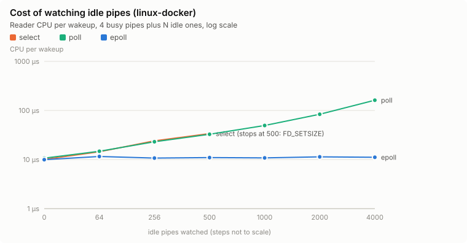
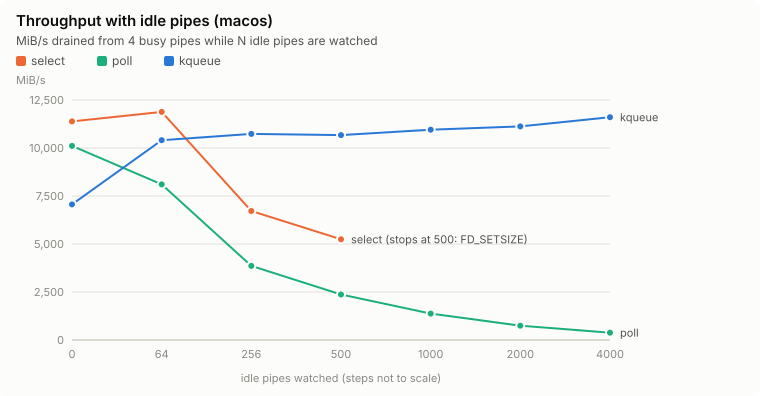

# logmux

[](https://github.com/akrai37/logmux/actions/workflows/ci.yml)

A multiprocess log collector in C. It runs many child processes and merges their stdout
and stderr into one timestamped log:
- **It never blocks on any single child.**
- **It never loses, duplicates, reorders or tears a line.** Lines from different
  children never mix.
- **It survives children that crash, hang, flood or trickle.**

Its event loop has four interchangeable backends: `select`, `poll`, `epoll` (Linux) and
`kqueue` (macOS). Each one's cost is measured.

```
$ logmux -c 'web=echo "listening on :8080"; sleep 0.2; echo "GET /health 200"' \
         -c 'worker=echo "connecting to queue" >&2; sleep 0.1; echo "job 17 done"; printf "shutting down"' \
         -c 'flaky=echo starting; kill -SEGV $$'
0.009292 flaky out: starting
0.009309 web out: listening on :8080
0.009356 worker err: connecting to queue
0.009472 flaky sys: killed by signal 11 (Segmentation fault: 11)
0.119783 worker out: job 17 done
0.119955 worker out~ shutting down
0.119959 worker sys: exited with status 0
0.214850 web out: GET /health 200
0.215108 web sys: exited with status 0
```

Each record is `<seconds> <child> <stream><mark> <text>`. The stream is `out`, `err`, or
`sys` (logmux's own notes about the child: exit status, signal, timeouts). The mark is:

| Mark | Meaning |
|---|---|
| `:` | A complete line |
| `+` | A piece of a line longer than `--max-line`; more follows |
| `~` | A final line that had no newline |

## Results

Comparisons are made **within one platform only**:
- **macOS:** native, on an Apple M2 laptop (4 performance + 4 efficiency cores, 8 GB),
  with `select`, `poll` and `kqueue`.
- **Linux:** a Linux VM on the *same laptop* (Docker Desktop: 8 vCPUs, 3.8 GiB, kernel
  6.12), with `select`, `poll` and `epoll`. The VM adds overhead, so treat the Linux
  numbers as relative comparisons between backends, not absolute figures.

Every point is the median of 5 runs, and the laptop was in normal use. The full tables
with min–max spreads, and the machine details, are in
[results/summary.md](results/summary.md). [scripts/experiments.py](scripts/experiments.py)
reproduces them.

**The question:** a collector watching many pipes, most of them idle, with a few busy
ones carrying data. How much does each idle pipe cost? The benchmark, `logmux-bench`:
- **Pipes:** 4 busy pipes carrying 1 GiB in total, plus N idle pipes (open, never
  written).
- **Latency:** a pinger sends timestamps, which measure how quickly the loop notices new
  data.
- **What it times:** only the waiting and reading. Registering the pipes happens before
  the clock starts.

At **4,000 idle pipes**:

| | Linux: `epoll` | Linux: `poll` | macOS: `kqueue` | macOS: `poll` |
|---|---:|---:|---:|---:|
| Throughput | **8,223 MiB/s** | 785 MiB/s | **11,603 MiB/s** | 379 MiB/s |
| Reader CPU per wakeup | **11.1 µs** | 161.8 µs | **8.6 µs** | 656.7 µs |
| Latency to notice new data, p50 | **17 µs** | 221 µs | **14 µs** | 459 µs |

**`select` cannot be used at all past about 500 pipes.** It can only watch descriptors
numbered below `FD_SETSIZE` (1,024), and each pipe uses two descriptor numbers.





More charts: [CPU per wakeup on macOS](results/cpu_per_wakeup_macos.svg),
[throughput on Linux](results/throughput_linux-docker.svg).

### What the numbers show

- **`epoll` and `kqueue` cost the same whether 0 or 4,000 pipes are idle.**
  - *Why:* interest is registered with the kernel once, and a wait returns only the
    descriptors that are ready.
  - *Result:* CPU per wakeup stays flat, at about 11 µs on Linux and 9 µs on macOS.
- **`poll` and `select` pay for every watched descriptor on every wakeup.** The kernel
  checks each one, and the caller scans the whole array again for results.
  - *Result:* `poll`'s CPU per wakeup grows linearly with the idle count, to **14.6×**
    `epoll`'s at 4,000 idle pipes on Linux and **76×** `kqueue`'s on macOS.
  - *Knock-on effect:* time spent scanning is time not spent reading, so `poll`'s
    throughput falls **10.5×** (Linux) and **30.6×** (macOS) behind, and its latency to
    notice new data grows from about 15 µs to 221 µs and 459 µs.
- **`select` and `poll` differ by platform.** At 500 idle pipes on macOS, `select` costs
  far less per wakeup than `poll` (29 vs 105 µs), which fits a bitmap being cheaper to
  scan than an array of structs. On Linux the two are about equal (34 vs 33 µs). Either
  way, `select` stops at `FD_SETSIZE`.
- **With no idle pipes, the backends are equivalent.** The same holds when the full
  collector runs 16–256 children that all write as fast as they can: 2 million lines in
  0.27–0.39 s on every backend (Linux). The choice of backend matters exactly when many
  watched descriptors are quiet, which is the normal state for a log collector.
- **A Linux kernel limit almost spoiled the measurement.**
  - *What the first Linux run showed:* `epoll` and `poll` both lost 6–9× throughput past
    1,000 idle pipes.
  - *Why:* once a user's pipes hold `fs.pipe-user-pages-soft` pages (64 MiB by default),
    Linux gives *new* pipes 8 KiB buffers instead of 64 KiB. Measured: pipe 900 got
    65,536 bytes, pipe 1,000 got 8,192.
  - *The fix:* the busy pipes had been created after the idle ones, so they were the
    ones squeezed. The benchmark now creates them first. The same limit would hit any
    real collector that opens its busiest pipes last.
- **One noisy point:** in this run, `kqueue`'s point at 0 idle pipes dipped (median
  7,061 MiB/s, spread 4,908–7,716) below its points at 64+ idle (about 10,400–11,600). An
  earlier run measured 12,516 there. Nothing in the backend explains a dip at 0, and the
  laptop was in use. The spread is published rather than the point rerun.

## Correctness

Throughput only counts if no data is lost, so every claim above rests on these checks:

- **Exact verification of every byte.**
  - *The children:* the test program `logmux-child` writes lines generated from
    *(seed, child, sequence number)*, cut into `write()` calls of random sizes, so lines
    span reads.
  - *The check:* for every child and stream, the verifier regenerates the expected text
    and requires the log, joined back together, to match byte for byte. That rules out
    lost, duplicated, reordered, torn and interleaved lines in one comparison.
  - *The hostile children:* flooding, trickling one byte at a time, crashing mid-line,
    ending without a newline, closing stdout early, hanging, and writing 128 KiB to
    stderr before any stdout.
  - *Coverage:* every backend, with 18 children at once.
- **The verifier is tested too.** A dropped record, two swapped records and a single
  flipped bit must each be caught.
- **Negative controls: three deliberately broken collectors the tests require to fail.**
  Each reproduces a classic real bug.

  | Broken collector | What goes wrong | How the tests catch it |
  |---|---|---|
  | Creates all pipes up front, without close-on-exec | Children inherit their siblings' pipe ends, so a finished child's end-of-file waits for unrelated siblings | Its final line arrives after **1.5 s** (when the sibling exits) instead of **0.002 s** |
  | Reads each child's stdout to end-of-file before its stderr | Deadlock: the child blocks writing a full stderr pipe while the collector waits on stdout | A watchdog, calibrated from logmux's 0.03 s run, finds it still stuck at 3 s |
  | Writes each `read()` as a record, without reassembling lines | Lines that span reads are torn | The verifier reports the first torn byte |

- **Sanitizers.** All tests pass under AddressSanitizer and UBSan, plus LeakSanitizer
  on Linux. CI covers Linux (GCC and clang) and macOS (clang), so `epoll` and `kqueue`
  are each tested on their own platform.
- **Descriptor hygiene.** No file descriptors leak across runs. A descriptor above
  `FD_SETSIZE` is refused by `select` and served by every other backend.

### Bugs found while building it

- **ASan found a buffer overflow in the log writer.** The writer assumed a record always
  fits its buffer. The no-reassembly control produced one that didn't. Records of any
  size are now written whole.
- **A test that only worked by luck.** It built each child's `argv` as a C compound
  literal inside a loop. A compound literal's lifetime ends with each iteration, so
  every `argv` was dangling. On macOS the stale stack happened to survive. On Linux,
  GCC reused it, and all 100 children crashed before `exec`.
- **Leaks visible only on Linux.** LeakSanitizer is on by default with ASan on Linux but
  not on macOS. It found that the helper programs never freed their setup memory. In
  the test child, the leak report even landed on its stderr, and the exact verifier
  rejected it as unexpected output.
- **A portability trap.** `usleep` was removed from POSIX.1-2008. It compiled on macOS
  only because the build enables BSD extensions there, so it was replaced before
  reaching Linux.

## Design

- **No sibling ever holds another child's pipe ends.** Each child's pipes are created
  just before its `fork()`, with close-on-exec set, and the parent closes the write ends
  right after. Either measure alone prevents the inherited-pipe bug; together they also
  cover descriptors opened between spawns.
- **Children start clean.**
  - *Signals:* `SIGPIPE`, which logmux ignores, is reset to its default. Ignored signals
    survive `exec`; handled ones don't.
  - *Inputs:* stdin comes from `/dev/null`.
  - *Process groups:* each child gets its own, so a timeout or shutdown also reaches
    anything the child started, such as a background process holding the pipe open after
    its parent shell exited.
- **The self-pipe trick for signals.** The `SIGCHLD`, `SIGINT` and `SIGTERM` handlers only
  write a byte to a pipe the event loop watches. Reaping, timeouts and shutdown all run
  in the loop, never in a handler. Signals stay blocked across `fork()`, so a handler can
  never run in a child before `exec`.
- **Fairness.** One read per ready pipe per wakeup, with non-blocking pipes, so a child
  flooding output can't starve the others.
- **Records are atomic in the log.** A line is written only when it is complete or cut at
  `--max-line`, and each record is written whole.
- **Timeouts.** A child silent for `--hang-timeout` ms gets `SIGTERM`, then `SIGKILL`
  after `--grace` ms, sent to its whole process group. On `SIGINT` or `SIGTERM`, logmux
  forwards the signal to every child and drains what they already wrote before exiting.
- **Level-triggered polling throughout.** All four backends behave the same way, and
  end-of-file is reported as readable.

## Build and run

Needs CMake 3.20+ and a C11 compiler, on Linux or macOS.

```sh
cmake -S . -B build -DCMAKE_BUILD_TYPE=Release
cmake --build build -j
ctest --test-dir build -j4

./build/logmux -n 4 -- ./build/logmux-child --id 1 --lines 5 --mode both
./build/logmux --stats -c 'a=echo hi' -c 'b=echo oops >&2; exit 3'
./build/logmux --backend poll --hang-timeout 1000 -c 'stuck=sleep 60'
./build/logmux-bench --backend poll --idle 2000            # the event-loop benchmark
python3 scripts/experiments.py run --build build --label mymachine
python3 scripts/experiments.py report
```

`logmux --help` lists every option.

| CMake option | Default | Effect |
|---|---|---|
| `LOGMUX_SANITIZE` | `OFF` | Build with ASan and UBSan |
| `LOGMUX_WERROR` | `OFF` | Treat warnings as errors (on in CI) |
| `LOGMUX_BUILD_TESTS` | `ON` | Build the tests |

## Limitations

- **Hardware.** Everything was measured on one laptop. The Linux numbers come from a VM on
  that same laptop, not from bare-metal Linux, so compare backends within a platform,
  not platforms with each other.
- **Throughput depends on the output.** The log is written with blocking writes. A slow
  destination, such as a slow disk or a stalled pipe reader, slows collection down. Nothing
  is lost, and children block on their own full pipes.
- **Long lines are cut into pieces.** Lines longer than `--max-line` (default 4,096 bytes)
  come out as `+` pieces. Joining them back is up to the reader.
- **No log rotation, no structured output, no remote shipping.** logmux is the
  collection layer only.
- **Signals.** `logmux` handles its own `SIGINT`/`SIGTERM` but is not a full process
  supervisor: it doesn't restart children.

## Repository layout

```
include/logmux/, src/   poller.c (select/poll/epoll/kqueue), collector.c (the collector)
src/main.c              logmux command-line tool
include/logmux/testing.h  the deliberately broken collectors used as negative controls
tools/child.c           logmux-child: the fault-injecting test child
tools/bench.c           logmux-bench: the event-loop benchmark
tests/                  poller, collector, exact-verification and deadlock tests
scripts/experiments.py  runs the benchmarks per platform and builds the report
results/                measured results, tables and charts
```

## License

MIT, see [LICENSE](LICENSE).
